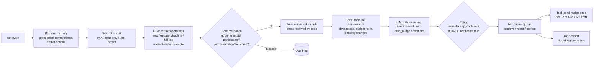

# CommitKeeper

**An email agent that remembers who promised what, and follows up for you.**

CommitKeeper reads your mailbox in review cycles and keeps a ledger of commitments in both directions: what you promised other people, and what they promised you. It notices when a promise is revised, kept or quietly forgotten, and decides the next step: wait, remind you, draft a polite follow-up, escalate, or ask you to clarify. Everything it learns is stored in SQLite, so each run builds on the last one, including after a restart.

It is **local-first**. A local LLM (qwen3:8b via [Ollama](https://ollama.com)) makes the judgement calls, deterministic code handles dates, permissions, validation and record-keeping, and nothing is ever sent without your approval.

```
Cycle 1  "I'll share the annotated dataset by Tuesday"           -> tracks: Bilal owes you, due Tue 3 Nov
Cycle 2  "Sorry, the server crashed. I need until Friday"        -> same item, new date pending YOUR approval; decides to WAIT
         (you approve)                                            -> 6 Nov becomes current, 3 Nov kept as history
Cycle 3  (new process) no dataset by Mon 9 Nov                   -> overdue vs the APPROVED date; drafts ONE nudge for approval
         (you approve; SMTP fails once; retry)                    -> delivered exactly once
Cycle 4  Bilal's auto-reply: "away until 14 November"            -> remembers 1 nudge was sent, reads the reply, WAITS
```

## Contents

- [Features](#features)
- [How it works](#how-it-works)
- [Install](#install)
- [Try it: four weeks in ten minutes](#try-it-four-weeks-in-ten-minutes)
- [Use it with a real mailbox](#use-it-with-a-real-mailbox)
- [Configuration](#configuration)
- [Command reference](#command-reference)
- [Evaluation](#evaluation)
- [Documentation](#documentation)
- [Project layout](#project-layout)
- [Limitations and roadmap](#limitations-and-roadmap)
- [Acknowledgements](#acknowledgements)
- [License](#license)

## Features

- **Two-way commitment tracking.** "I'll send it Friday" (you owe) and "We'll confirm by the 5th" (owed to you), each with the exact sentence it came from.
- **Persistent memory.** Commitments, deadline history, approvals, follow-ups and preferences live in SQLite and survive restarts. Every change is a new version; nothing is overwritten.
- **Evidence-aware decisions.** A revised deadline becomes a change you approve. An email with an attachment or link closes the item. A bare "already done" is held for your confirmation. An out-of-office reply means wait.
- **Safe by construction.** Outgoing email needs your approval, goes only to allowlisted addresses, respects a reminder limit and cooldown, and is delivered exactly once. Instructions hidden inside emails are quarantined and can never change recipients or settings.
- **Deterministic where it matters.** "By Thursday" becomes a date in code, not by the model. Vague deadlines ("sometime next week") are asked about, never guessed.
- **Crash-safe.** Each cycle checkpoints after every email, and a failed cycle resumes where it stopped without duplicating anything.
- **Reviewable.** Rich terminal views, an Excel register (your own notes survive re-export), an `.ics` calendar with deadlines, and a full audit log of every tool call, memory read/write and model decision.
- **Isolated profiles.** Several mailboxes can share one store without seeing each other's data.

## How it works



**Two LLM decisions; everything else is deterministic.**

1. **Extraction.** The model reads one email (quoted replies removed) together with the open commitments it already has with those people. It proposes `new`, `update_deadline` or `fulfilled` operations, constrained by a JSON schema and backed by an exact quote. Code rejects quotes that are not in the email, operations that target someone not on the email, and anything from a message that tries to instruct the agent.
2. **Next action.** For commitments that are due soon, overdue or have new evidence, code computes the facts. The model, with reasoning enabled, reads them plus the recent thread and picks an action. A policy layer then enforces the hard rules.

| Component | Role | Code |
|---|---|---|
| Mail reader | read-only IMAP or `.eml` export; only unseen messages | [tools/mail_source.py](commitkeeper/tools/mail_source.py) |
| Memory | scoped, versioned, logged SQLite access | [memory.py](commitkeeper/memory.py), [db.py](commitkeeper/db.py) |
| Deadline resolver | phrase → date, relative to the email's Date header | [dates.py](commitkeeper/dates.py) |
| Safety and policy | injection detector, evidence checks, action policy | [safety.py](commitkeeper/safety.py) |
| Nudge sender | SMTP or UNSENT draft; approval-gated, exactly once | [tools/mail_sender.py](commitkeeper/tools/mail_sender.py) |
| Exporter | Excel register and `.ics` calendar | [tools/exporter.py](commitkeeper/tools/exporter.py) |
| Agent loop | fetch → extract → validate → plan → approve → act | [agent.py](commitkeeper/agent.py), [prompts.py](commitkeeper/prompts.py) |

**What it does on its own, and what it asks first.** It reads mail, updates its own store and shows reminders on its own. It **asks you** before changing an approved deadline, accepting a completion claim with no attachment or link, and sending any email. It **never** emails a non-allowlisted address, exceeds the reminder limit, nudges before the due date, or follows instructions found inside an email.

## Install

You need Python 3.10+, Ollama, and about 6.5 GB of free GPU memory (or a patient CPU).

| Tested with | Version |
|---|---|
| OS / GPU | Windows 11, NVIDIA RTX 5060 Laptop GPU (8 GB) |
| Python | 3.14.5 |
| Ollama | 0.34.1 |
| Model | `qwen3:8b`, 8.2B parameters, Q4_K_M, digest `500a1f067a9f` |
| Python packages | pinned in [requirements.txt](requirements.txt) (openpyxl 3.1.5, rich 15.0.0, python-dateutil 3.0.0, requests 2.34.2, python-dotenv 1.2.4, pytest 9.2.0, aiosmtpd 1.4.6) |

```bash
ollama pull qwen3:8b
```

```bash
git clone https://github.com/D3aThNdDeMiSe/commitkeeper.git
```

Inside the cloned folder, create a virtual environment and install CommitKeeper with its development extras:

```bash
python -m venv .venv
```

```bash
.venv/Scripts/python -m pip install -e ".[dev]"
```

(on macOS/Linux use `.venv/bin/python`). Activate the environment (`.venv\Scripts\activate` or `source .venv/bin/activate`) so the `commitkeeper` command is on your path, then create your configuration:

```bash
cp .env.example .env
```

The defaults run fully offline: mail comes from the fictional sample mailbox in `data/fixtures/`, and follow-ups are written as **UNSENT drafts** to `exports/outbox/`. Pinned versions for exact reproduction are in `requirements.txt`. The unit tests cover the deterministic parts and need no LLM:

```bash
python -m pytest -q
```

## Try it: four weeks in ten minutes

The sample mailbox belongs to Maryam, a fictional student and research assistant. Her supervisor, teammates and course staff make and change promises over four weeks. `--now` sets the review clock so the whole story plays out in minutes. Every command is a separate process, so the agent only knows what is in SQLite.

```bash
commitkeeper profile add maryam --name "Maryam Siddiqui" --email maryam@example.com
```

```bash
commitkeeper run-cycle --profile maryam --now 2026-11-02T09:00:00+05:00
```

```bash
commitkeeper run-cycle --profile maryam --now 2026-11-04T09:00:00+05:00
```

Cycle 2 skips a forwarded duplicate, quarantines a prompt-injection email, asks about a vague deadline, and holds Bilal's new date for your approval. Approve it and answer the question. The IDs below are from the reference run; use the ones your run prints under **Needs you**:

```bash
commitkeeper approve A-maryam-003 --profile maryam
```

```bash
commitkeeper correct C-maryam-006 --profile maryam --due 2026-11-12 --reason "Hina confirmed by phone"
```

```bash
commitkeeper run-cycle --profile maryam --now 2026-11-09T09:00:00+05:00
```

Cycle 3 closes the chapter from its attachment, holds Dr. Imran's unsupported "already sent" claim, proposes a course deadline extension, and drafts a nudge to Bilal. Approve the extension and the nudge, and reject the claim:

```bash
commitkeeper approve A-maryam-006 --profile maryam
```

```bash
commitkeeper approve A-maryam-007 --profile maryam
```

```bash
commitkeeper reject A-maryam-005 --profile maryam --note "no comments received"
```

Deliver the nudge. Setting `CK_SIMULATE_FAILURE=smtp_once` makes the first attempt fail so you can see the retry. In PowerShell, use `$env:CK_SIMULATE_FAILURE="smtp_once"` and clear it afterwards:

```bash
CK_SIMULATE_FAILURE=smtp_once commitkeeper send --profile maryam
```

```bash
commitkeeper send --profile maryam
```

```bash
commitkeeper run-cycle --profile maryam --now 2026-11-12T09:00:00+05:00
```

In cycle 4 the agent remembers its nudge, reads Bilal's auto-reply and waits. It reminds Maryam about the two items now due today and drafts a first follow-up to Dr. Imran. Then look around:

```bash
commitkeeper status --profile maryam
```

```bash
commitkeeper history C-maryam-004 --profile maryam
```

```bash
commitkeeper export --profile maryam
```

## Use it with a real mailbox

CommitKeeper connects over IMAP/SMTP with an **App Password**, so the account needs 2-Step Verification. Many school and work accounts don't allow it.

1. Use a dedicated Gmail account (recommended) or a **label** in your own. The first cycle processes every unseen message in the configured folders, and their text is stored locally in the database and audit log. Point `CK_IMAP_FOLDERS` at a small folder, not a full inbox.
2. Enable 2-Step Verification and create an App Password at [myaccount.google.com/apppasswords](https://myaccount.google.com/apppasswords).
3. In `.env`, set the IMAP/SMTP user and password, `CK_SEND_MODE=smtp`, and keep `CK_ROUTE_TO` set to your own address until you trust the setup. Every nudge then lands in your inbox, with the intended recipient shown in the subject.
4. Create a profile with your own address and run cycles with `--source imap` (omit `--now` to use the real clock):

```bash
commitkeeper profile add me --name "Your Name" --email you@example.com
```

```bash
commitkeeper run-cycle --profile me --source imap
```

To replay the sample story against a real inbox, `seed-imap --profile maryam --until <date>` copies the fixture emails into it first. The reader opens folders read-only (`BODY.PEEK`) and ignores the nudges CommitKeeper sent itself. A live run is documented in [results/live_imap_test.md](results/live_imap_test.md).

## Configuration

All settings come from environment variables or `.env` (git-ignored). See [.env.example](.env.example).

| Variable | Default | Purpose |
|---|---|---|
| `CK_MODEL` | `qwen3:8b` | Ollama model |
| `CK_OLLAMA_URL` | `http://localhost:11434` | Ollama server |
| `CK_NUM_CTX` | `8192` | context size (8k keeps qwen3:8b fully on an 8 GB GPU) |
| `CK_THINK_DECIDE` | `true` | let the model reason before choosing the next action |
| `CK_SEED` | `42` | sampling seed (temperature is always 0) |
| `CK_DB`, `CK_LOG_DIR`, `CK_EXPORT_DIR`, `CK_FIXTURES` | `data/…`, `logs`, `exports`, `data/fixtures` | storage locations |
| `CK_ALLOWLIST` | (empty) | the only addresses that may ever be nudged |
| `CK_SEND_MODE` | `dry_run` | `dry_run` writes UNSENT drafts; `smtp` really sends |
| `CK_ROUTE_TO` | (empty) | deliver every nudge to this address instead (testing) |
| `CK_IMAP_HOST`, `CK_IMAP_USER`, `CK_IMAP_PASSWORD`, `CK_IMAP_FOLDERS` | Gmail, –, –, `INBOX` | mailbox to read |
| `CK_SMTP_HOST`, `CK_SMTP_PORT`, `CK_SMTP_SSL`, `CK_SMTP_USER`, `CK_SMTP_PASSWORD`, `CK_SMTP_FROM` | Gmail, 465, true, –, –, user | outgoing mail |
| `CK_SIMULATE_FAILURE` | (empty) | testing: `fetch`, `smtp_once` or `llm_after:N` |

Per-profile preferences (`commitkeeper prefs set …`) are versioned in the store: `max_reminders` (default 2), `nudge_cooldown_days` (2) and `remind_days_before` (1).

## Command reference

| Command | What it does |
|---|---|
| `init` | create the SQLite store and its schema (other commands also do this on first use) |
| `profile add <id> --name --email` / `profile list` | create or list isolated profiles |
| `run-cycle --profile <id> [--source eml\|imap] [--now ISO] [--no-memory]` | run one review cycle (resumes a failed one) |
| `status --profile <id>` | commitments, recommended actions, evidence, items needing you |
| `approve` / `reject <action> --profile <id> [--note]` | decide on deadline changes, completion claims and nudges |
| `correct <commitment> --profile <id> --due DATE --reason` | set a date yourself (new version, history kept) |
| `resolve <commitment> --profile <id> --status done\|open --reason` | close or reopen manually |
| `send --profile <id>` | deliver approved nudges; safe to repeat |
| `history <commitment> --profile <id>` | every version and action for one commitment |
| `prefs show\|set --profile <id>` | view or change versioned preferences |
| `export --profile <id>` | write the Excel register and `.ics` calendar |
| `log --profile <id> [--kind] [--cycle] [--tail N]` | audit log |
| `metrics --profile <id> [--cycle]` | model calls, latency and tokens |
| `seed-imap --profile <id> --until ISO` | copy sample emails into a test inbox |
| `purge --profile <id> --yes` | delete everything stored for a profile |

`commitkeeper` and `python -m commitkeeper` are interchangeable.

## Evaluation

```bash
python scenarios/run_scenarios.py
```

The harness replays the sample story through the real CLI, with every step a new process, and checks 12 scenarios: initial use, later use, restart, correction, isolation, missing or conflicting evidence, tool failure and retry, prompt injection, duplicate forward, reminder cap, crash and resume, and an evidence-driven decision. It also reruns three later cycles with memory retrieval switched off, samples factual claims, counts duplicate deliveries, and records model usage. A full run takes about 20 minutes on an RTX 5060 Laptop GPU.

| Reference run | Result |
|---|---|
| Scenarios passed | **12/12** |
| Later cycles handled correctly, memory on vs off | **3/3 vs 0/3** |
| Sampled factual claims correct | 5/5 |
| Duplicate deliveries in retry/crash tests | 0 |
| Key decisions stable across 3 seeds | 18/18 |
| Model calls per cycle / LLM time | 5–7 / 29–61 s, $0 (local) |

Details are in [results/scenario_results.md](results/scenario_results.md), [results/decision_stability.md](results/decision_stability.md), [results/smtp_local_test.txt](results/smtp_local_test.txt) and [results/excel_manual_columns_test.md](results/excel_manual_columns_test.md). Every run's transcript, audit log, database snapshots and exports are in `results/runs/`.

## Documentation

- [Design and evaluation](docs/design.md): architecture, decision loop, memory lifecycle, full results, and the failures found and fixed during development.
- [Memory design](docs/memory_design.md): what is stored, when it is read, how it is corrected and deleted. The schema itself is in [commitkeeper/db.py](commitkeeper/db.py).
- Technical report: [PDF](docs/report/CommitKeeper_Technical_Report_I22-0395.pdf) / [Word](docs/report/CommitKeeper_Technical_Report_I22-0395.docx).

## Project layout

```
commitkeeper/          the agent package
  agent.py             review cycle, approvals, sending
  memory.py            scoped, logged, versioned SQLite access
  db.py                schema
  prompts.py           the two LLM prompts and their JSON schemas
  safety.py            injection detector, evidence checks, action policy
  dates.py             deterministic deadline resolution
  llm.py               Ollama client (logs prompts, latency, tokens)
  tools/               mail_source, mail_sender, exporter
  cli.py               command-line interface
data/make_fixtures.py  generates the fictional sample mailboxes in data/fixtures/
scenarios/             evaluation harness
tests/                 unit tests (no LLM needed)
results/               evaluation results, transcripts, logs and exports
docs/                  design docs, architecture figure, technical report
```

## Limitations and roadmap

- An 8B local model is not always right. Schema-constrained output, evidence checks and the policy layer reduce errors but do not remove them, and the evaluation reports the failures it finds.
- The injection detector is pattern-based plus a model flag, so a cleverly worded attack could slip past detection. Even then it cannot change recipients, permissions or the allowlist, because no code path lets email content do that.
- "By Friday" means the next Friday on or after the email date; "next Friday" is treated as ambiguous and asked about.
- Planned: OAuth sign-in (Gmail/Outlook) instead of App Passwords, a per-cycle message cap for large mailboxes, calendar sync through an API, and a small web dashboard.

## Acknowledgements

Built with AI pair-programming assistance (Claude Code). The model is qwen3:8b (Qwen, Apache-2.0) served by Ollama. All people, addresses and emails in `data/fixtures/` are fictional.

## License

[MIT](LICENSE) © 2026 Immad Shah
