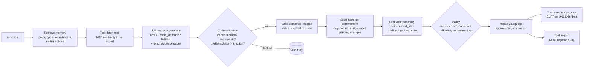

# CommitKeeper: inbox commitment tracker with persistent memory

Agentic AI Assignment 2: *Practical Agentic Systems with Persistent Memory*, catalogue idea **D13 (Inbox commitment tracker)**.

CommitKeeper reads your email in review cycles and keeps track of **what you promised others and what others promised you**. Each cycle it decides what to do next: wait, remind you, draft a polite follow-up, escalate, or ask you to clarify. It remembers every commitment, deadline change, approval and follow-up across runs and process restarts, so later decisions build on earlier ones. A local LLM (qwen3:8b via Ollama) makes the judgement calls. Deterministic code handles dates, permissions, validation, de-duplication and record updates.

```
Cycle 1  "I'll share the annotated dataset by Tuesday"           -> tracks: Bilal owes you, due Tue 3 Nov
Cycle 2  "Sorry, the server crashed. I need until Friday"        -> same item, new date pending YOUR approval; decides to WAIT
         (you approve)                                            -> 6 Nov becomes current, 3 Nov kept as history
Cycle 3  (new process) no dataset by Mon 9 Nov                   -> overdue vs the APPROVED date; drafts ONE nudge for approval
         (you approve; SMTP fails once; retry)                    -> delivered exactly once
Cycle 4  Bilal's auto-reply: "away until 14 November"            -> remembers 1 nudge was sent, reads the reply, WAITS
```

## Contents

- [How it works](#how-it-works)
- [Setup](#setup)
- [Run the demo](#run-the-demo)
- [Live Gmail integration (optional)](#live-gmail-integration-optional)
- [Evaluation](#evaluation)
- [Repository layout](#repository-layout)
- [Limitations](#limitations)
- [Disclosure](#disclosure)

## How it works



**Two LLM decisions, everything else deterministic.**

1. *Extraction:* the model reads one email (quoted replies removed) together with the open commitments it already has with those people. It proposes `new`, `update_deadline` or `fulfilled` operations, each constrained by a JSON schema with an exact quote. Code then rejects any quote that is not in the email, any operation that targets someone not on the email, and anything coming from a message that tries to instruct the agent. Code also turns "by Thursday" into a date relative to the email's Date header. Vague phrases ("sometime next week") become a clarification question instead of an invented date.
2. *Next action:* for commitments that are due soon, overdue or have new evidence, code computes the facts. The model, with reasoning enabled, reads them plus the recent thread and picks an action. The policy layer then enforces hard rules: no nudge before the due date, reminder limit, cooldown, allowlisted recipients only. This is where evidence changes the plan, for example a "server crashed, need until Friday" email or an out-of-office reply turns a nudge into *wait*.

| Tool | Kind | File |
|---|---|---|
| Mail reader (IMAP read-only, or labelled .eml export) | evidence retrieval | [tools/mail_source.py](commitkeeper/tools/mail_source.py) |
| Commitment store (SQLite, versioned, idempotent) | persistent write | [memory.py](commitkeeper/memory.py) |
| Deadline resolver + policy checker | deterministic calculation/permission | [dates.py](commitkeeper/dates.py), [safety.py](commitkeeper/safety.py) |
| Nudge sender (SMTP or UNSENT draft, approval-gated) | controlled action | [tools/mail_sender.py](commitkeeper/tools/mail_sender.py) |
| Excel register + .ics calendar | persistent review view | [tools/exporter.py](commitkeeper/tools/exporter.py) |

**Approval boundaries.** The agent reads mail, writes its own store and shows reminders on its own. It **asks you** before changing an approved deadline, accepting a completion claim that has no attachment or link, and sending any email. It **never** emails a non-allowlisted address, exceeds the reminder limit, nudges before the due date, or acts on instructions found inside an email.

Memory design and lifecycle: [docs/memory_design.md](docs/memory_design.md). One-page proposal: [docs/proposal.md](docs/proposal.md).

## Setup

Requirements: Python 3.10+ (tested on 3.14.5, Windows 11), [Ollama](https://ollama.com) 0.34+, and about 6.5 GB of free GPU memory (or a patient CPU).

```bash
ollama pull qwen3:8b
```

```bash
python -m venv .venv
```

```bash
.venv/Scripts/python -m pip install -r requirements.txt
```

(on macOS/Linux use `.venv/bin/python`). Activate the environment so that `python` below means the venv's Python: `.venv\Scripts\activate` (Windows) or `source .venv/bin/activate`.

```bash
cp .env.example .env
```

The defaults in `.env.example` run fully offline: mail comes from the fictional `.eml` exports in `data/fixtures/`, and nudges are written as **UNSENT drafts** to `exports/outbox/`.

Run the unit tests (deterministic parts, no LLM needed):

```bash
.venv/Scripts/python -m pytest -q
```

## Run the demo

The clock is set manually with `--now` so four weeks of email fit in a 10-minute demo. Every command below is a **separate process**: the agent only knows what is in SQLite. The fixtures are regenerated with `python data/make_fixtures.py`.

```bash
python -m commitkeeper profile add maryam --name "Maryam Siddiqui" --email maryam@example.com
```

```bash
python -m commitkeeper run-cycle --profile maryam --now 2026-11-02T09:00:00+05:00
```

```bash
python -m commitkeeper run-cycle --profile maryam --now 2026-11-04T09:00:00+05:00
```

Cycle 2 shows a duplicate forward skipped, the injection email quarantined, the vague poster deadline sent for clarification, and Bilal's new date waiting for approval. Approve it and answer the clarification. The IDs below are from the reference run (`results/runs/main/transcript.txt`); use the ones your run prints under **Needs you**:

```bash
python -m commitkeeper approve A-maryam-003 --profile maryam
```

```bash
python -m commitkeeper correct C-maryam-006 --profile maryam --due 2026-11-12 --reason "Hina confirmed by phone"
```

Restart and continue:

```bash
python -m commitkeeper run-cycle --profile maryam --now 2026-11-09T09:00:00+05:00
```

Cycle 3 asks for three decisions: approve the Assignment 3 extension, approve the drafted nudge to Bilal, and reject Dr. Imran's unsupported "already sent" claim:

```bash
python -m commitkeeper approve A-maryam-006 --profile maryam
```

```bash
python -m commitkeeper approve A-maryam-007 --profile maryam
```

```bash
python -m commitkeeper reject A-maryam-005 --profile maryam --note "no comments received"
```

Show failure and retry. The first `send` simulates an SMTP outage, the second delivers, and a third would have nothing left to do. In PowerShell, set the variable first with `$env:CK_SIMULATE_FAILURE="smtp_once"`, run `send`, then clear it with `Remove-Item Env:CK_SIMULATE_FAILURE`:

```bash
CK_SIMULATE_FAILURE=smtp_once python -m commitkeeper send --profile maryam
```

```bash
python -m commitkeeper send --profile maryam
```

Cycle 4 shows memory paying off. It remembers the nudge it already sent, reads Bilal's auto-reply and waits. It reminds you about Assignment 3 and the poster, both due today under the approved and corrected dates, and drafts a first follow-up to Dr. Imran:

```bash
python -m commitkeeper run-cycle --profile maryam --now 2026-11-12T09:00:00+05:00
```

Inspect state, history, the audit log and the review views:

```bash
python -m commitkeeper status --profile maryam
```

```bash
python -m commitkeeper history C-maryam-004 --profile maryam
```

```bash
python -m commitkeeper log --profile maryam --kind decision --tail 20
```

```bash
python -m commitkeeper export --profile maryam
```

Other commands: `prefs show|set`, `reject`, `resolve`, `metrics`, `purge`, `seed-imap`. Run `python -m commitkeeper -h` for help. A minute-by-minute script for the live demonstration is in [docs/demo_script.md](docs/demo_script.md).

## Live Gmail integration (optional)

1. Create a throwaway Gmail account, enable 2-Step Verification and create an **App Password**.
2. In `.env` set `CK_IMAP_USER`, `CK_IMAP_PASSWORD`, `CK_SMTP_USER`, `CK_SMTP_PASSWORD`, `CK_SMTP_FROM` to that account, `CK_SEND_MODE=smtp`, and `CK_ROUTE_TO=<the same address>` so every nudge lands in your own inbox (the subject shows the original fictional recipient).
3. Copy the fixture emails into the real inbox up to a given date, then read them back over IMAP (read-only, `BODY.PEEK`):

```bash
python -m commitkeeper seed-imap --profile maryam --until 2026-11-02T09:00:00+05:00
```

```bash
python -m commitkeeper run-cycle --profile maryam --source imap --now 2026-11-02T09:00:00+05:00
```

Approval, delivery outcome and failure are recorded separately in the `actions` table (`decided_at`, `status`/`sent_at`/`delivered_to`, `attempts`/`last_error`). Messages the agent sent itself are ignored when read back.

## Evaluation

```bash
python scenarios/run_scenarios.py
```

This replays the storyline through the CLI (each step a new process) and checks 12 scenarios: the 8 compulsory ones plus duplicate forward, reminder cap, crash/resume and evidence-driven decision. It also compares memory on vs off on three later cycles, samples 5 factual claims for correctness, counts duplicate deliveries, and reports model calls, latency and tokens. It takes about 20 minutes on an RTX 5060 Laptop GPU.

| Result (reference run) | |
|---|---|
| Scenario pass rate | **12/12** |
| Memory on vs off (3 later cycles, same inputs) | **3/3 vs 0/3** |
| Sampled factual claims correct | 5/5 |
| Duplicate deliveries in retry/crash tests | 0 |
| Key decisions stable across 3 seeds | 18/18 |
| Model calls per cycle / LLM time | 5–7 calls / 25–45 s, $0 (local) |

Details: [results/scenario_results.md](results/scenario_results.md), [results/decision_stability.md](results/decision_stability.md), [results/smtp_local_test.txt](results/smtp_local_test.txt), [results/excel_manual_columns_test.md](results/excel_manual_columns_test.md). Transcripts, logs, database snapshots and exports for every run are in `results/runs/`. Failures found and fixed during development are listed in the technical report ([docs/technical_report.md](docs/technical_report.md), section 6).

## Repository layout

```
commitkeeper/          agent package
  agent.py             review cycle, approvals, sending
  memory.py            scoped, logged, versioned SQLite access
  db.py                schema
  prompts.py           the two LLM prompts + JSON schemas
  safety.py            injection detector, evidence check, action policy
  dates.py             deterministic deadline resolution
  llm.py               Ollama client (logs prompt, latency, tokens)
  tools/               mail_source, mail_sender, exporter
  cli.py               command-line interface
data/make_fixtures.py  generates the fictional mailboxes in data/fixtures/
scenarios/             evaluation harness
tests/                 unit tests (no LLM)
results/               scenario results, metrics, transcripts, logs, exports
docs/                  proposal, memory design, demo script, technical report
```

## Limitations

- An 8B local model is not always right. Prompts, schema-constrained output, evidence checks and the policy layer reduce errors but do not remove them. The evaluation reports the failures it finds.
- The injection detector is pattern-based plus an LLM flag. A cleverly worded attack could slip past detection, but even then it cannot change recipients, permissions or the allowlist, because no code path lets email content do that.
- Weekday resolution assumes "by Friday" means the next Friday on or after the email date; "next Friday" is treated as ambiguous and asked about.
- One mailbox per profile; no OAuth (Gmail App Password over IMAP/SMTP).

## Disclosure

Developed with AI assistance (Claude Code) for scaffolding, code and documentation; all design decisions, testing and the final submission are the student's responsibility. External libraries are listed in `requirements.txt`; the model is qwen3:8b (Alibaba Qwen, Apache-2.0) served by Ollama. All people, addresses and emails in `data/fixtures/` are fictional.
