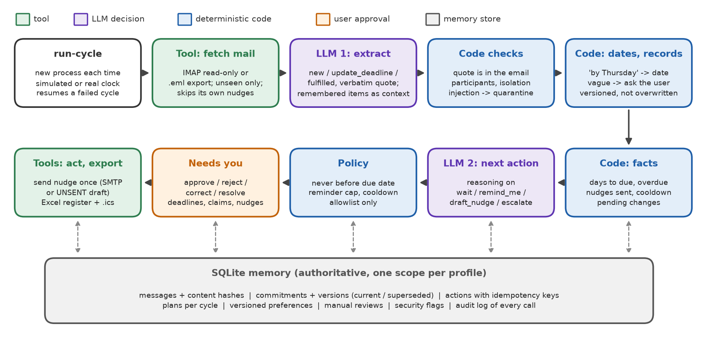

# CommitKeeper: design and evaluation

How CommitKeeper works, why it is built this way, and how well it performs on the reference scenarios. For installation and usage, see the [README](../README.md).

## 1. Problem and goals

Anyone who works over email makes and receives many small promises: "send me the chapter by Thursday", "I'll share the dataset by Tuesday", "the deadline is extended to the 12th". Keeping track is recurring and stateful work. Each time new mail arrives you have to remember what was promised, notice when a promise moved or was kept, and decide whom to chase without nagging. A stateless assistant cannot do this: it would re-extract the same items, miss that "I need until Friday" refers to an earlier promise, and nudge someone it already nudged.

**Goals.** For one mailbox per profile, across any number of review cycles and process restarts:

1. extract commitments in both directions, each with an evidence quote and a due date resolved by code;
2. link later emails to existing commitments (revised deadline, fulfilment, unsupported claim, duplicate);
3. recommend a next action per commitment using remembered history, with approval before any deadline change, unsupported closure or outgoing email;
4. deliver approved nudges exactly once to allowlisted owned addresses;
5. keep history (superseded versions), isolate profiles, resist instructions inside emails, and log every tool call, memory access and decision.

## 2. Architecture

A single agent with tools, plus a deterministic control layer (Figure 1). The coordinator is `agent.py`. The LLM is qwen3:8b served locally by Ollama (Q4_K_M, 8k context, temperature 0, seed 42), with JSON-schema-constrained output. It is used in exactly two places:

| Decision | Input | Output | Validated by |
|---|---|---|---|
| Extraction (`_process_message`) | one email (quoted replies removed) plus the profile's open commitments with the people on that email (memory) | `new` / `update_deadline` / `fulfilled` operations with owner, description, verbatim deadline phrase and evidence quote | quote must occur in the email; target commitment must belong to the profile and involve a participant of the email; the evidence must not be the original promise; dates resolved by `dates.py`; quarantine if the email addresses the agent |
| Next action (`_plan`), reasoning mode on | code-computed facts (days to due, overdue days, nudges sent, cooldown, pending change), action history, last three messages with the contact | `wait` / `remind_me` / `draft_nudge` / `escalate` plus reason, cited message IDs and nudge text | `safety.apply_action_policy`: valid for the direction, never before the due date, reminder limit, cooldown, allowlist |



Enum constraints in the schema stop the model from inventing addresses or commitment IDs. Commitments that need no attention (due later, nothing new) are handled by a rule, which keeps model calls proportional to what actually changed.

**Approval boundaries.** Autonomous: reading mail, writing its own store, showing reminders and escalations. Needs the user: deadline changes (`approve_deadline_change`), completion claims without attachment or link (`confirm_completion`), vague deadlines (`ask_clarification`), and every outgoing nudge (`draft_nudge`). Forbidden: non-allowlisted recipients, more nudges than the limit, nudges before the due date, and any action requested inside an email.

## 3. Decision loop

```
run-cycle(profile, clock)
  resume the unfinished cycle if one exists, else open a new one          [cycles.stage = started]
  fetch: new emails only (Message-ID not stored, Date <= clock)            -> messages      [fetched]
         content hash -> duplicate_of for forwards / re-sends
  for each unprocessed email:                                               (checkpoint per email)
     skip duplicates; LLM extract with remembered commitments as context
     injection detector or LLM flag -> quarantine, block all operations
     validate -> create commitment | pending version + approval | done | claimed_done + confirmation
  plan: for each active commitment                                                          [extracted]
     needs_clarification / claimed_done -> waiting for the user (rule)
     not due soon and nothing new -> wait (rule)
     else facts -> LLM decision -> policy -> plan row (+ action with idempotency key)       [planned]
user: approve / reject / correct / resolve          (versions superseded, never overwritten)
send: deliver approved or failed nudges; sent ones are never re-sent
```

The model's decision changes the plan in observable ways. In cycle 2 the dataset is overdue, so a stateless rule would nudge, but the model reads Bilal's "I need until Friday" and chooses `wait`. In cycle 4 the policy would allow a second nudge, but the model reads the automatic reply ("away until 14 November") and waits again. When the policy overrides the model (for example a nudge proposed before the due date), the plan is labelled `llm+policy` and the override is logged.

## 4. Tools

1. **Mail reader** (`tools/mail_source.py`): read-only IMAP (`readonly=True`, `BODY.PEEK`) against an owned test account, or a folder of `.eml` exports labelled `eml_export`. It returns only unseen, not-future messages and ignores nudges the agent sent itself. It was verified live against an owned test Gmail account (`results/live_imap_test.md`).
2. **Commitment store** (`memory.py`): SQLite reads and writes scoped by profile, with versioning and idempotency keys. Every read and write is logged.
3. **Deadline resolver and policy checker** (`dates.py`, `safety.py`): deterministic dates, injection detection, evidence verification and action policy. Unit-tested in `tests/test_core.py`.
4. **Nudge sender** (`tools/mail_sender.py`): SMTP, or an UNSENT draft in dry-run mode, only for approved actions. Approval (`decided_at`), delivery (`status`, `sent_at`, `delivered_to`) and failure (`attempts`, `last_error`) are recorded separately. An optional `CK_ROUTE_TO` delivers to an owned test inbox. This was verified against a local SMTP server (`results/smtp_local_test.txt`).
5. **Exporter** (`tools/exporter.py`): an Excel register (Register / Deadline history / Actions / About) whose manual columns are read back and preserved, and an `.ics` calendar with stable UIDs and SEQUENCE = version.

## 5. Memory lifecycle

SQLite is authoritative (see `docs/memory_design.md` for the full table). *Working state* is the cycle checkpoint and the per-email `processed` flags. *Long-term memory* is commitments and their versions, actions (approvals, delivery outcomes), per-cycle plans, versioned preferences and manual reviews. *Source knowledge* is the stored emails with content hashes. Every version keeps its source message, evidence quote, approval type and `superseded_at`, so the register can always answer "what was the date before, and who changed it". Corrections create a new version and never edit the old one. Deletion is explicit (`purge --profile`). Isolation is enforced in the memory layer: every query filters by `profile_id`, and a foreign ID raises `IsolationError`. The `--no-memory` switch hides everything from earlier cycles and is used only for the comparison.

## 6. Evaluation

**Method.** `scenarios/run_scenarios.py` drives the real CLI. Every step is a new `python -m commitkeeper` process with its own environment, so restarts happen throughout. A main storyline (4 cycles for *maryam*, 1 for *omar*) is followed by dedicated runs for crash/resume and the reminder cap, and then the memory comparison from database snapshots. Settings: qwen3:8b, temperature 0, seed 42, 8k context, reasoning on for next-action decisions. Full transcripts, logs, databases and exports are in `results/runs/`. The scenario table with expected and observed behaviour and evidence is `results/scenario_results.md`.

**Scenario results: 12/12 passed (100%).**

| ID | Scenario | Key evidence |
|---|---|---|
| S1 | Initial use | 4 emails became 5 commitments in both directions; all 5 directions and due dates matched the ground truth ("by Thursday" from Fri 30 Oct = 5 Nov) |
| S2 | Later use | Bilal's delay attached to the *existing* commitment as a pending change 3 Nov → 6 Nov; script closed from the commit link; the LLM chose `wait` citing m09 |
| S3 | Process restart | new process; only 3 new emails read; 12 stored, none twice; earlier commitments retrieved; chapter closed from the attachment |
| S4 | Correction | v1 kept as superseded; cycle-3 prompt used the approved 6 Nov; Assignment 3 and the poster reminded on their approved/corrected date (12 Nov) |
| S5 | Isolation | Omar's agent saw no Maryam records even for the shared contact; cross-profile `approve`/`history` refused and logged |
| S6 | Missing/conflicting evidence | "sometime next week" → no invented date, clarification requested; "I have already sent you my comments" without attachment → `claimed_done`, confirmation required |
| S7 | Tool failure and retry | simulated SMTP 421 logged; retry delivered (attempts = 2); third `send` did nothing; 1 outbox file |
| S8 | Untrusted instruction | m07 flagged by 5 detectors (ignore-instructions, addresses-ai, system-override, exfiltration, bulk-status-change; the allowlist phrase was *not* matched because the address contains dots, but there is no code path from email to the allowlist); 0 records or actions derived from it |
| S9 | Duplicate forward | m06 stored with `duplicate_of = m04`; one Assignment 3 commitment |
| S10 | Preference update + reminder cap | `max_reminders` 2 → 1 versioned; agent escalated instead of nudging Bilal again |
| S11 | Crash mid-cycle and resume | mailbox outage, then LLM outage after 2 emails; the rerun resumed the same cycle; 4 emails processed once; same 5 commitments as a clean run |
| S12 | Evidence changes the action | with 1 of 2 nudges used (policy would allow another), the LLM read the auto-reply and chose `wait` |

**Memory enabled vs disabled** (same snapshot, inputs and model settings; expected outcome written before running): memory on **3/3**, memory off **0/3**. Without memory, cycle 2 turned Bilal's delay into a second dataset commitment and never closed the script commitment. Cycle 3 could not link the attachment or the completion claim to anything. Cycle 4 produced no reminders at all, because the commitments due that day were invisible.

**Evidence correctness:** 5/5 sampled claims had a quote that appears verbatim in the source email and the correct current due date. **Duplicate actions in retry tests:** 0 duplicate deliveries (SMTP retry and crash/resume). **Decision stability:** the six key next-action decisions replayed with three seeds gave 18/18 expected actions (`results/decision_stability.md`). **Real integrations:** a live cycle read the demo emails over IMAP from an owned test Gmail account and produced the same 5 commitments as the offline run (`results/live_imap_test.md`). SMTP delivery was verified against a local SMTP server, including allowlist blocking and no re-send (`results/smtp_local_test.txt`), and the Gmail SMTP login was accepted.

**Model calls, latency and cost** (main run; qwen3:8b on an RTX 5060 Laptop GPU, about 6.2 GB VRAM, $0):

| Cycle | LLM calls (extract + decide) | LLM time | Prompt / output tokens | Wall time |
|---|---|---|---|---|
| c1 | 6 (4 + 2) | 44.9 s | 5,228 / 2,316 | 47.5 s |
| c2 | 7 (4 + 3) | 45.1 s | 6,012 / 2,480 | 47.8 s |
| c3 | 5 (3 + 2) | 28.6 s | 4,682 / 1,591 | 30.1 s |
| c4 | 5 (1 + 4) | 60.8 s | 4,089 / 3,389 | 62.1 s |

Extraction calls take about 2 s; reasoning decisions take 10–30 s. Commitments that need no attention are decided by rule, so model calls scale with what changed rather than with the size of the register.

### What the evaluation caught during development

The final numbers come after these fixes. Each fix was driven by a failing scenario or a logged LLM response:

| # | Failure observed | Root cause | Fix |
|---|---|---|---|
| 1 | Bilal's reply "closed" Maryam's own promise | the quoted `>` text of her earlier email was treated as new evidence | strip quoted replies before extraction; code rejects evidence equal to the original promise |
| 2 | Promises made *to* the user were missed | prompt examples only covered the user's obligations | prompt describes both directions, with two worked examples |
| 3 | Course announcement ignored, then extracted with the course as owner | "newsletters are not commitments" rule; owner ambiguity | announcements that set a deadline are the user's; third example |
| 4 | Extension email copied the *old* deadline phrase | model copied from the known-commitment list | "new deadline from this email" rule; code checks the phrase is in the email, otherwise resolves from the verified quote |
| 5 | Date resolved as 2003-11-12 | dateutil fuzzy parse read "Assignment 3" as the year | extract the date phrase first, then parse; regression test |
| 6 | Without reasoning, nudges chosen where waiting was right (2 of 3 replayed cases) | no deliberation over evidence | reasoning ("thinking") on for next-action decisions only |
| 7 | With reasoning: waited on a delay already applied, then nudged despite "away until 14 Nov" | could not tell stale from current evidence | code marks the email that set the current due date; rule 1 bounded to dates still in the future and stated to override rules 2-4. Replayed with 3 seeds: 12/12 expected actions |
| 8 | Action history dated before the emails | domain timestamps used real time, emails a simulated clock | domain records use the review clock; the audit log keeps real time |
| 9 | Two scenario checks failed while the agent was correct | S3 counted emails after cycle 4 instead of cycle 3; S10 counted a legitimate nudge to a different person | checks corrected; the earlier 10/12 and 11/12 runs are described here rather than hidden |
| 10 | Poster due today (after the user's correction) got `wait` in one run and `remind_me` in another with identical inputs | the superseded "sometime next week" email looked like a newer date; GPU run-to-run variation at temperature 0 | code marks every email sent before the current due date was set as "already accounted for"; check added to S4; seed sweep 18/18 (`results/decision_stability.md`) |

## 7. Limitations

- Small-model errors remain possible: missed commitments, a wrong owner, or an over-eager nudge. They are reduced by schema enums, few-shot examples, verbatim evidence checks, quoted-text stripping, reasoning mode for decisions and the policy layer, but not eliminated. The evaluation reports failures honestly.
- Prompts were tuned on the demo fixtures (13 + 3 emails). Performance on real, messier mail (HTML newsletters, long threads, other languages) is not measured.
- The injection detector is pattern-based plus a model flag, so a novel phrasing could evade detection. The structural guarantees (no code path from email to recipients, allowlist, preferences or unrelated commitments) still hold.
- "by Friday" is resolved as the next Friday on or after the email date; "next Friday" is asked about. Time zones come from the email header; the time of day is ignored.
- Gmail access uses an App Password over IMAP/SMTP, not OAuth, so it needs an account that allows 2-Step Verification. Organisation-managed accounts (school or work) often do not. The scenario suite runs on `.eml` exports for reproducibility; the live Gmail read is documented separately.
- The IMAP reader processes every unseen message in the configured folders, so the first cycle on a large mailbox is slow. Point `CK_IMAP_FOLDERS` at a dedicated label.

## 8. Implementation decisions

- **SQLite instead of a vector store.** The data is structured; exact lookups, UNIQUE constraints and versioning matter more than semantic recall.
- **The LLM never does arithmetic or permissions.** Dates, counts, cooldowns and allowlists are code, so they are reproducible and unit-tested.
- **Reasoning only where it pays.** Without reasoning, qwen3:8b nudged in 2 of 3 replayed decisions where waiting was right; with reasoning it chose correctly in all three, at about 15 s per decision. Extraction stays in fast mode (about 2 s per email).
- **Every CLI command is a new process.** Restarts are the normal case, not a special demo trick.
- **Simulated clock.** `--now` makes four weeks reproducible in minutes. Domain records use the review clock and the audit log uses real time.

## Acknowledgements

Built with AI pair-programming assistance (Claude Code). Libraries: openpyxl, rich, python-dateutil, requests, python-dotenv, pytest, aiosmtpd (versions in `requirements.txt`). Model: qwen3:8b (Apache-2.0) via Ollama. All sample data is fictional.

## References

1. Qwen Team (2025). *Qwen3 Technical Report.* arXiv:2505.09388.
2. Ollama. *API reference: chat endpoint, structured outputs (`format` JSON schema) and thinking.* https://github.com/ollama/ollama/blob/main/docs/api.md
3. Crispin, M. (2003). *RFC 3501: Internet Message Access Protocol, Version 4rev1.* IETF.
4. Klensin, J. (2008). *RFC 5321: Simple Mail Transfer Protocol.* IETF.
5. Desruisseaux, B. (2009). *RFC 5545: Internet Calendaring and Scheduling Core Object Specification (iCalendar).* IETF.
6. OWASP (2025). *Top 10 for Large Language Model Applications: LLM01 Prompt Injection.* https://genai.owasp.org/llm-top-10/
7. Yao, S. et al. (2023). *ReAct: Synergizing Reasoning and Acting in Language Models.* ICLR 2023.
8. Packer, C. et al. (2023). *MemGPT: Towards LLMs as Operating Systems.* arXiv:2310.08560.

## Evidence index

| Evidence | File |
|---|---|
| Scenario table (input, saved state, expected, observed, result, evidence), memory comparison, sampled claims, duplicates, model usage | `results/scenario_results.md` (+ `.csv`, `summary.json`) |
| Per-run CLI transcripts, audit logs (`events.jsonl`), SQLite databases and snapshots, Excel/ICS/outbox exports | `results/runs/<run>/` |
| Decision stability across seeds | `results/decision_stability.md` |
| Live Gmail IMAP read | `results/live_imap_test.md` |
| SMTP delivery, allowlist block, no re-send | `results/smtp_local_test.txt` |
| Excel manual columns preserved on re-export | `results/excel_manual_columns_test.md` |
| Unit tests (dates, policy, injection, idempotency, isolation, versioning) | `tests/test_core.py` |
